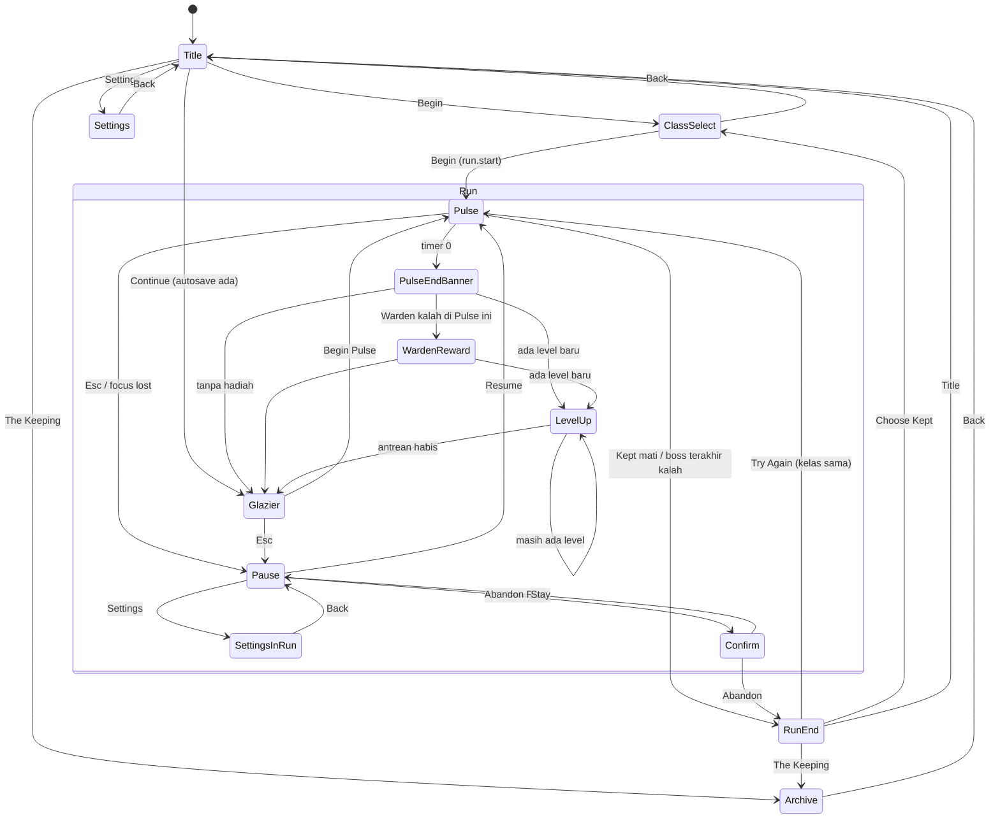

# Shardfall: Spesifikasi UI

Pemilik: UI Programmer (UI). Status: versi 1.1 (M1-04, 2026-11-17), perbaikan review M0 diterapkan. Reviewer: CD (rasa dan gaya), LP (teknis dan kontrak), QA (aksesibilitas).

**Perubahan versi 1.1 (review `docs/reviews/M0-cd.md` 2.10 dan `docs/reviews/M0-lp.md` UI):** Keepsake menjadi Memento (identifier `memento`); Archive menjadi The Keeping di teks (identifier layar tetap `archive`); Depth menjadi Crack; judul menang "Light Kept" plus layar antara Vitrine Steady (Tingkat C); judul level-up "Temper" dengan subjudul "Lv {n}"; Merge menjadi Fuse di teks (identifier dan command tetap `merge`); HUD slot timer menjadi bar HP Warden berlabel "Held" saat Pulse ditahan; bagian 12 memakai kontrak final architecture v2.1; `uiScale` dari piksel fisik; kualitas default Medium; volume 80/70/100/80 plus slider Interface, Mono Audio, Reduce Repeats; id cue UI mengikuti `docs/audio-list.md`; nama event `PlayerDamaged` dan `EnemyDamaged`; id layar `credits`.
Dasar: `docs/pillars.md`, `docs/style-guide.md` bagian 2, `docs/vision.md`. Bila bertentangan, pilar yang menang (Pilar 2 > Pilar 4 > Pilar 1 > Pilar 3).
Wireframe: `docs/ui/wireframes/` (satu file per layar, tautan di tiap bagian).

Penanda: **[Asumsi]** keputusan sementara yang perlu dikonfirmasi pemilik wilayah lain. **[Usulan ke X]** butuh persetujuan peran X.

---

## 1. Prinsip UI

1. **Satu pandangan, satu keputusan.** Setiap layar pilihan menampilkan semua info yang dibutuhkan tanpa scroll, tooltip berlapis, atau pindah layar (P4-e).
2. **HUD diam saat Pulse.** Hanya HP, waktu Pulse, Glint, cooldown Rite, dan level dengan bar XP tipis. Semua di tepi layar (style guide 2.2).
3. **Keyboard penuh, mouse setara.** Setiap aksi bisa dilakukan dengan keyboard saja dan dengan mouse saja. Hover mouse memindahkan fokus, jadi keduanya tidak pernah berselisih.
4. **UI membaca, sim memutuskan.** UI tidak menghitung harga, sinergi, atau hasil merge. UI menampilkan view dari sim dan mengirim command. Sim memvalidasi semuanya.
5. **Tidak ada warna sebagai satu-satunya tanda.** Setiap status juga punya bentuk, ikon, atau teks (mode buta warna, bagian 9).
6. **Animasi tidak pernah memblokir input.** Input saat animasi langsung menyelesaikan animasi itu.

## 2. Teknologi UI (keputusan)

**Keputusan: DOM dan CSS overlay di atas canvas three.js, TypeScript vanilla tanpa framework UI.**

| Opsi | Kelebihan | Kekurangan | Putusan |
|---|---|---|---|
| **DOM/CSS overlay** | Tata letak, wrap teks, fokus, dan event keyboard sudah tersedia di browser. Aksesibilitas (tombol asli, `aria-*`, live region) hampir gratis. Iterasi cepat dengan CSS. Tidak ikut kena post-processing (UI selalu tajam). Screenshot Playwright menangkap DOM dan canvas sekaligus | Ketajaman pixel butuh disiplin (skala integer). DOM yang sering berubah bisa mahal bila tidak hati-hati | **Dipilih** |
| UI di dalam three.js (sprite dan teks di scene) | Satu pipeline render, pixel pasti konsisten | Wrap teks, fokus, input, dan aksesibilitas harus dibangun sendiri. Lambat dikerjakan dalam satu malam. Ikut kena DoF dan bloom bila tidak dipisah | Ditolak |
| Canvas 2D terpisah di atas | Pixel tepat, ringan | Masalah yang sama dengan opsi three.js: fokus, wrap, aksesibilitas manual | Ditolak |

Alasan utama: kecepatan produksi (Producer menetapkan waktu satu malam) dan aksesibilitas (navigasi keyboard penuh, pembaca layar untuk menu). Dua kekurangan DOM ditangani begini:

- **Ketajaman pixel:** semua ukuran memakai satuan UI integer (bagian 7). Ikon dibuat dari data ke `<canvas>` kecil dengan `image-rendering: pixelated`. Font bitmap tim nanti dirender ke canvas per string lewat satu komponen `PixelText`, sehingga mengganti placeholder ke font bitmap tidak menyentuh kode layar.
- **Performa:** DOM HUD kecil (kurang dari 30 elemen). HUD hanya menulis ke DOM bila nilainya berubah. Bar memakai `transform: scaleX()` agar tidak memicu layout ulang. Container HUD memakai `pointer-events: none`.
- **Angka damage tidak memakai DOM.** Jumlahnya bisa ratusan per detik, jadi digambar di three.js oleh render layer (atlas glyph dari font yang sama). UI hanya memiliki pengaturannya. [Usulan ke LP]

Tanpa dependensi npm baru. Preact sempat dipertimbangkan (kecil, nyaman), tapi tidak perlu untuk jumlah layar ini dan butuh izin dependensi. Pola yang dipakai: antarmuka `Screen` sederhana (`mount`, `update(view)`, `unmount`, `onNav`) plus helper kecil pembuat elemen. Keputusan ini sejalan dengan keputusan LP nomor 11 di `docs/tech/architecture.md` (UI DOM tanpa framework di atas canvas, `three` satu-satunya dependensi runtime). Struktur folder induk milik LP; usulan isi `src/ui/` ada di bagian 12.3.

Struktur DOM:

```
#game-root
  canvas#stage            three.js (arena, aktor, angka damage)
  #ui-root                CSS var --u (satuan UI) dan --fs (skala font)
    #hud                  aria-hidden saat Pulse, pointer-events: none
    #screen-layer         satu layar aktif (menu, toko, level-up, dst.)
    #modal-layer          dialog konfirmasi
    #banner-layer         banner sesaat (nama Warden, "Pulse 7 Held")
    #live-region          aria-live="polite" untuk pengumuman pembaca layar
```

## 3. Daftar layar

| ID | Layar | Kapan | Wireframe |
|---|---|---|---|
| S01 | Judul (menu utama) | Saat game dibuka | [01-title.md](wireframes/01-title.md) |
| S02 | Pilih Kept (pilih kelas) | Dari Judul atau akhir run | [02-class-select.md](wireframes/02-class-select.md) |
| S03 | HUD Pulse | Selama Pulse | [03-hud.md](wireframes/03-hud.md) |
| S04 | Pilihan level-up (1 dari 3) | Awal fase toko, sekali per level yang didapat | [04-level-up.md](wireframes/04-level-up.md) |
| S04b | Hadiah Warden (pilih Memento) | Awal fase toko setelah Warden dikalahkan | [04-level-up.md](wireframes/04-level-up.md) |
| S05 | The Glazier (toko) | Antar Pulse | [05-glazier.md](wireframes/05-glazier.md) |
| S06 | Jeda (dengan ringkasan build) | Esc saat Pulse atau toko | [06-pause.md](wireframes/06-pause.md) |
| S06b | Dialog konfirmasi | Aksi yang tidak bisa dibatalkan | [06-pause.md](wireframes/06-pause.md) |
| S07 | Pengaturan | Dari Judul atau Jeda | [07-settings.md](wireframes/07-settings.md) |
| S08 | Akhir run (kalah atau menang) | Kept mati, boss terakhir kalah, atau run ditinggalkan | [08-run-end.md](wireframes/08-run-end.md) |
| S09 | The Keeping (meta dan unlock, identifier `archive`) | Dari Judul atau akhir run | [09-archive.md](wireframes/09-archive.md) |

Elemen sesaat (bukan layar, tanpa input): banner nama Warden atau boss, banner akhir Pulse, petunjuk kontrol di Pulse 1, pesan "jendela terlalu kecil".

**ID layar untuk tes** (dipetakan dari `AppScreen` LP plus `view.phase`; dipakai hook `goToScreen(id)` QA, atribut `data-screen` pada root layar, dan nama screenshot di `test-plan.md` 7.4): `title`, `class-select`, `pulse`, `level-up`, `warden-reward`, `glazier`, `pause`, `confirm`, `settings`, `run-end` (varian `run-lost` dan `run-won`), `archive`, `credits`. Elemen interaktif punya atribut `data-ui` yang stabil (misalnya `data-ui="shop-offer-2"`, `data-ui="shop-reroll"`) agar tes Playwright tidak bergantung pada teks.

Tingkat konten (vision.md 7.2): Tingkat A butuh S01, S03, S04, S05, S06, S07 minimal (kualitas dan volume), S08. Pilih Kept (S02) dan Arsip (S09) baru penting di Tingkat B (3 kelas, Silt). Di Tingkat A, S02 tetap tampil dengan satu kelas agar alur tidak berubah nanti.

## 4. Alur antar layar



Versi ASCII (untuk dibaca tanpa renderer):

```
Title --Begin--> ClassSelect --Begin--> [RUN]
  |                  ^                     |
  +--> Archive       |                     v
  +--Continue--> Glazier (autosave)
  +--> Settings      |     +---------> Pulse <-------------------+
                     |     |             |  \--Esc--> Pause --> Settings
                     |     |          timer 0          |  \--> Confirm --Abandon--+
                     |     |             v             |                          |
                     |     |       PulseEndBanner      +--Resume--> (kembali)     |
                     |     |             v                                        |
                     |     |   [WardenReward] -> [LevelUp x N] -> Glazier         |
                     |     |                                         |            |
                     |     +-------------- Begin Pulse --------------+            |
                     |                                                            |
                     |   Kept mati atau boss terakhir kalah --> RunEnd <----------+
                     +----------- Choose Kept ----------------------+
                                  Try Again --> Pulse (kelas sama)
```

Aturan alur:
- **Antrean hadiah.** Sim memberi antrean pilihan di awal fase toko. UI menampilkannya satu per satu sesuai urutan dari sim. [Asumsi] Urutan default: hadiah Warden dulu, lalu level-up, lalu toko. GD boleh mengubah urutan tanpa mengubah UI.
- **Banner akhir Pulse** tampil sekitar 1 detik sambil kilatan kaca melarutkan Unlit (style guide 1.6), lalu layar berikutnya muncul. Banner bisa dilewati dengan input apa pun.
- **Jeda otomatis** saat tab browser kehilangan fokus (`visibilitychange` atau `blur`) selama Pulse. Bisa dimatikan di pengaturan.
- **Tidak ada menu bertingkat lebih dari satu level dalam run** (P4-c). Jeda menampilkan ringkasan build langsung di panelnya, tanpa sub-layar. Pengaturan dari Jeda adalah satu-satunya level kedua, dan berada di luar alur keputusan.
- **Autosave (keputusan LP, architecture.md bagian 12):** run disimpan saat masuk toko dan setelah setiap command toko. Menutup tab di tengah Pulse berarti melanjutkan dari toko terakhir lewat tombol Continue di Judul. Save yang tidak bisa dimuat dibuang dengan pesan singkat (`ui.title.save_lost`), tanpa crash.
- [Asumsi] Meninggalkan run (Abandon) menghasilkan layar akhir run seperti kalah. Apakah tetap dapat Silt adalah aturan GD.

## 5. Isi tiap layar

### S01 Judul
- Latar: arena bioma pertama dalam mode diam (kamera tetap, lentera berkedip, debu kaca melayang). Tidak ada Unlit.
- Judul game (teks besar), kalimat pengait di bawahnya.
- Menu vertikal: Continue (hanya bila ada autosave run), New Run (`ui.title.begin`), The Keeping (Tingkat B), Settings, Credits. Tidak ada tombol Quit (browser).
- Begin saat ada autosave: run lama ditimpa. Karena tidak bisa dibatalkan, Begin memakai pola "Press again" (lihat S09) bila autosave ada.
- Pojok kanan atas: saldo Silt (hanya bila Silt aktif, Tingkat B).
- Pojok kanan bawah: nomor versi build (label kecil `dust`).
- Fokus awal: Continue bila ada, selain itu Begin.

### S02 Pilih Kept
- Kiri: daftar kelas (baris: potret kecil, nama kelas 1 kata, satu baris peran). Kelas terkunci tampil sebagai siluet dengan ikon gembok dan biaya Silt.
- Kanan: panel detail kelas yang difokus: potret besar (sprite 24x24 dirender 2x), nama, satu baris tagline, senjata awal (ikon, nama, efek 2 baris), Rite (ikon, nama, efek 2 baris, cooldown dalam detik), 3 sampai 4 chip stat awal yang paling membedakan.
- Bawah: tombol Begin dan Back. Bila tingkat kesulitan sudah terbuka (Tingkat C): pemilih "Crack" dengan panah kiri dan kanan.
- Kelas terkunci tidak bisa dimulai. Tombol Begin diganti teks "Unlock in The Keeping" dan tombol pintas ke The Keeping.
- Fokus awal: kelas terakhir yang dimainkan.

### S03 HUD Pulse
Hanya elemen ini (style guide 2.2):

| Elemen | Posisi | Isi | Perilaku |
|---|---|---|---|
| HP | Kiri atas | Bar `kept-blue` 120 x 8 satuan, teks "42/60" di dalam atau di kanan bar | Damage: bagian yang hilang berubah putih lalu menyusut dalam 300 ms (chip). Di bawah 30%: bingkai bar berdenyut `danger-red` plus ikon retak kecil (bentuk, bukan hanya warna) |
| Level dan XP | Tepat di bawah HP | Label "Lv 4" plus bar tipis 120 x 3 `kept-gold` | Saat naik level: bar berkedip emas sekali, angka level naik. Level-up tidak membuka layar saat Pulse; pilihan muncul di fase toko |
| Waktu Pulse | Tengah atas | Label kecil "Pulse 7" di atas, timer besar "0:24" angka tabular (atau bar HP boss / Warden "Held", lihat di bawah) | Hitung mundur per detik. 5 detik terakhir: angka `kept-gold`, sedikit membesar tiap detik (mati bila kurangi efek). Tidak memakai merah karena akhir Pulse adalah hal baik |
| Glint | Kanan atas | Ikon Glint 8 x 8 plus angka tabular | Angka naik dengan tick cepat saat memungut. Tidak ada animasi terbang ke HUD (mengurangi kekacauan) |
| Rite | Tengah bawah | Ikon Rite 32 x 32 dengan isian cooldown dari bawah ke atas, sisa detik di tengah, petunjuk tombol di bawah ("Space") | Saat siap: bingkai `kept-gold` dan denyut sekali. Saat ditekan tapi belum siap: ikon bergetar kecil plus suara "denied" |

- HUD berada di pita atas dan bawah layar, yang juga merupakan pita DoF (style guide 1.7). Overlay DOM tidak ikut blur, jadi HUD tetap tajam, dan tengah arena bebas.
- Margin HUD 8 satuan dari tepi viewport. HUD menempel ke tepi viewport nyata, bukan ke area aman 640x360, agar layar lebar tidak membuat HUD masuk ke tengah.
- **Slot timer berubah isi, jumlah elemen tetap (style guide 2.2, CD K3):**
  - **Pulse boss** (`pulse.isBoss`, `ticksTotal = 0`): slot timer menjadi bar HP boss dari `pulse.boss` (`BigFoeView`): nama boss di atas (`enemy.nameKey`), isian `danger-violet`, bingkai tipis, tanpa angka besar. Fase boss tampil sebagai pip kecil (1 sampai 3).
  - **Warden menahan Pulse** (`pulse.overtime` dan `pulse.wardenAlive`): komponen bar yang sama dari `pulse.warden`, label "Held" (`ui.hud.held`) di atas bar plus nama Warden. Pemain selalu tahu bahwa Pulse berakhir saat Warden jatuh.
  - Mengamuk (`enraged`) menambah ikon kecil di kanan bar (bentuk, bukan hanya warna).
- **Elemen sesaat di HUD:**
  - Banner Warden atau boss: nama plus julukan di bawah timer, bingkai `danger-violet`, 2.5 detik, tanpa input.
  - Petunjuk kontrol di Pulse 1 run pertama: "WASD Move / Space Rite" di tengah bawah di atas ikon Rite, memudar setelah 6 detik atau setelah pemain bergerak dan memakai Rite.
- Bukan milik HUD: kilat merah di tepi layar saat kena hit (VFX, style guide 1.8), angka damage (three.js).

### S04 Pilihan level-up
- Judul "Temper", subjudul "Lv 5" (Pilar 4: angka level tetap cepat dibaca), dan penghitung antrean "1 of 2" bila ada lebih dari satu level.
- 3 kartu bertumpuk vertikal di tengah (format kartu baris, bagian 6.1). Setiap kartu: ikon stat besar, nama, efek 1 sampai 2 baris, angka tombol pintas 1, 2, 3.
- Ringkasan stat kecil di kanan: nilai stat sekarang. Saat kartu difokus, stat yang terdampak menampilkan nilai baru ("Speed 110 > 118" dengan nilai baru `kept-gold`). Ini menjawab "apa yang berubah" tanpa hitungan (P4-a).
- [Asumsi] Tidak ada reroll level-up. Bila GD menambahkannya, tombol Reroll muncul di bawah kartu dengan pola yang sama seperti toko.
- Kunci input 300 ms saat layar muncul (bagian 8.4).
- Fokus awal: kartu 1.

### S04b Hadiah Warden
- Sama dengan S04, judul "Take a Memento" plus nama Warden yang dikalahkan sebagai subjudul.
- Kartu Memento menampilkan baris tag dan flavor (warna `dust`), sama seperti kartu toko, tanpa harga.
- Jumlah pilihan dari data GD (layout mendukung 2 sampai 3).

### S05 The Glazier
Layar paling penting. Semua di satu layar tanpa scroll (P4-e, kriteria tolak Pilar 4).

| Area | Isi |
|---|---|
| Bar atas | Judul "The Glazier", label "Next: Pulse 8", HP sekarang (bila ada penyembuhan antar Pulse), saldo Glint besar di kanan |
| Kolom kiri | Potret the Glazier (48 x 48) dan satu baris ucapan pendek (opsional, dari WR). Di bawahnya **panel Tag**: satu baris per tag yang dimiliki (ikon tag, nama, pip ambang, angka "3/4") |
| Kolom tengah | **4 kartu tawaran** bertumpuk vertikal (jumlah dari data GD, layout mendukung 3 sampai 5). Format kartu baris (6.1) dengan harga, tombol gembok, dan lencana Fuse bila berlaku |
| Kolom kanan | **Inventaris**: slot senjata (grid 3 x 2, slot kosong terlihat), Memento (grid ikon kecil). Tombol "Stats" mengganti isi kolom ini menjadi daftar stat (tetap di layar yang sama, bukan menu baru) |
| Bar bawah | Tombol Reroll dengan biaya Glint, tombol Begin Pulse di kanan bawah, petunjuk tombol |

Perilaku keputusan cepat:
- **Pratinjau sinergi.** Saat kartu tawaran difokus, panel Tag menampilkan pip bayangan "+1" pada tag milik kartu itu. Bila pembelian akan melewati ambang, baris tag itu bersinar emas dan menampilkan satu baris efek ambang baru ("Unlocks: ..."). Tag yang belum dimiliki muncul sementara di panel dengan tanda "New".
- **Pratinjau Fuse.** Bila tawaran sama dengan item yang dimiliki dan bisa digabung (`ShopOfferView.mergeSlot >= 0`), kartu menampilkan lencana "Fuse > II" (tier dari `mergeToTier`). Slot senjata yang akan tergabung ikut menyala.
- **Tidak mampu beli.** Harga dan tombol beli tampil abu redup dengan ikon Glint bergaris miring. Tidak memakai merah (style guide 1.3). Menekan beli tetap memberi umpan balik "Not enough Glint" (getar kecil plus suara denied plus pengumuman pembaca layar).
- **Slot penuh.** Bila senjata baru tidak muat dan tidak bisa merge, kartu menampilkan "No free slot" di tempat lencana. Aturan jual atau ganti adalah milik GD. Aksi Sell dan Fuse ada di slot inventaris (fokus slot, tekan X atau M, atau klik tombol kecil di slot), bukan di menu baru. Slot dengan `canMerge` menampilkan tombol Fuse.
- **Gembok.** Ikon gembok di setiap kartu. Kartu terkunci punya bingkai bergaris dan ikon gembok tertutup. Aturan gembok (bertahan setelah reroll, gratis atau tidak) milik GD.
- **Setelah membeli,** slot kartu berubah menjadi kosong bertuliskan "Taken" (tidak bergeser), agar posisi kartu lain dan tombol pintasnya tetap sama.
- **Langkah beli:** fokus kartu lalu Enter (2 input), atau tekan angka slot (1 input), atau satu klik pada tombol harga (P4-c).
- [Asumsi] Toko tanpa batas waktu. Bila GD menambahkan timer, timer tampil di bar atas di sebelah judul.
- Fokus awal: kartu tawaran pertama yang mampu dibeli. Bila tidak ada, tombol Begin Pulse.

### S06 Jeda
- Lapisan gelap di atas arena yang membeku (opasitas 60%).
- Kiri: menu Resume, Settings, Abandon Run.
- Kanan: ringkasan build hanya-baca: senjata dan tiernya, Memento (fokus atau hover menampilkan nama, efek, dan flavor di panel kecil di bawah grid), panel Tag, stat utama, Pulse sekarang dan waktu run.
- Esc atau P menutup jeda (Resume). Fokus awal: Resume.
- **Lanjut dari jeda saat Pulse:** hitung mundur singkat "3, 2, 1" di slot timer selama total 900 ms sebelum sim berjalan lagi, agar pemain tidak langsung kena damage (saran QA A-06). Tombol gerak yang ditahan selama hitung mundur sudah dihitung sehingga pemain bisa langsung bergerak saat sim jalan. Dari jeda di toko atau level-up tidak ada hitung mundur.
- Jeda tersedia di Pulse, level-up, hadiah Warden, toko, dan saat banner Warden atau boss tampil (A-06).

### S06b Dialog konfirmasi
- Dipakai hanya untuk aksi yang tidak bisa dibatalkan dan bukan bagian alur keputusan cepat: Abandon Run, reset pengaturan, hapus data simpan.
- Judul pertanyaan, dua tombol. Fokus awal selalu pada pilihan aman ("Stay"). Esc sama dengan pilihan aman.
- Membeli, reroll, dan memilih kartu tidak pernah memakai dialog (kriteria tolak Pilar 4).

### S07 Pengaturan
Empat tab dalam satu layar: Graphics, Audio, Controls, Accessibility. Perubahan langsung berlaku dan langsung disimpan, tanpa tombol Apply.

| Tab | Opsi | Nilai (default tebal) |
|---|---|---|
| Graphics | Quality | Low, **Medium**, High. Default Medium (target perangkat P-REF, review LP). Low mematikan DoF, bloom, kilau kaca (P3-f) |
| | Screen shake | 0 sampai 100, langkah 10, **100** |
| | Fullscreen | **Off**, On |
| Audio | Master, Music, Sound Effects, Interface | 0 sampai 100, langkah 10. Default **80 / 70 / 100 / 80** (AU). Masing-masing bisa 0 (A-09). Interface = bus `ui` |
| | Mono Audio | **Off**, On (AU 8.7) |
| | Reduce Repeats | **Off**, On (AU 8.7: meredam SFX berulang) |
| | Mute when unfocused | Off, **On** |
| Controls | Remap gameplay: Move Up, Move Down, Move Left, Move Right, Rite, Pause | Default di bagian 8.1. Tiap aksi punya 2 binding |
| | Remap menu: Confirm, Back, Reroll, Lock, Begin Pulse, Stats | Default di bagian 8.1 |
| | Reset controls | Dengan konfirmasi |
| Accessibility | Text size | **Normal**, Large, Largest (bagian 7.3) |
| | Reduce effects | **Off**, On (default On bila `prefers-reduced-motion`, A-11) |
| | Damage numbers | **On**, Off |
| | Color vision | **Off**, Protanopia, Deuteranopia, Tritanopia (palet milik AD) |
| | Pause when unfocused | Off, **On** |
| | Show flavor text | **On**, Off |
| | Solid panels | **Off**, On (panel opasitas 100%, tanpa kilau kaca) |
| | Shop timer (hanya bila GD memberi timer toko) | **On**, Off, atau Extended (A-12) |

- Remap: pilih aksi, teks berubah menjadi "Press a key", tombol berikutnya menjadi binding. Esc membatalkan perekaman. Bila tombol sudah dipakai aksi lain dalam konteks yang sama, kedua binding ditukar dan ditampilkan catatan singkat ("Swapped with Rite.").
- Pemetaan memakai `KeyboardEvent.code` (posisi fisik), label tombol di layar memakai nama tombol sesuai tata letak keyboard pemain (mengikuti QA A-01).
- **Jalur aman menu:** Confirm dan Back bisa di-remap, tapi Enter dan Esc selalu tetap berfungsi sebagai Confirm dan Back di layar menu, sebagai cadangan tetap yang tidak bisa dihapus. Pemain tidak pernah bisa mengunci dirinya keluar dari menu.
- Disimpan oleh app di `localStorage` kunci `shardfall.settings.v1` (architecture.md bagian 12). UI hanya menampilkan dan memanggil `AppActions.applySettings` dengan objek `Settings` baru (bertingkat `graphics`, `audio`, `access`, `keybinds`; architecture 6.11). Default ada di `src/app/settings.ts` (LP).
- M1 (M1-04): tab Graphics, Audio, Accessibility fungsional. Remap Controls menyusul di M2 (tab tampil dengan daftar binding hanya-baca).

### S08 Akhir run
- Judul besar: kalah "Kept Lost" dengan subjudul "Another wakes beneath the glass." atau menang "Light Kept" (teks final dari WR). Tingkat C: setelah boss bioma yang bukan terakhir tampil layar antara "Vitrine Steady" (bukan akhir run), memakai tata letak yang sama dengan tombol Continue. Teks contoh dari style guide 4.1.
- **Penyebab kematian:** "Felled by [nama Unlit atau Warden]" plus ikon sumbernya. Mendukung uji "aku mati karena..." (style guide 5.7).
- Statistik ringkas: Pulse tercapai dari total, waktu run, Unlit dilarutkan, Glint dikumpulkan.
- Build akhir: ikon senjata dengan tier, ikon Memento, 1 sampai 2 tag dominan.
- Silt didapat: angka naik dari 0 dalam sekitar 800 ms (langsung bila kurangi efek), saldo baru. Bila ada yang kini bisa dibuka, label "New unlock available" dengan tombol ke The Keeping.
- Tombol: Try Again (kelas sama, fokus awal), Choose Kept, The Keeping (Tingkat B), Title.
- Kunci input 500 ms saat layar muncul, agar tombol yang ditekan saat mati tidak langsung memulai run baru.

### S09 The Keeping (identifier `archive`)
- Dua tab: Kept dan Mementos. Saldo Silt di kanan atas.
- Tab Kept: daftar kelas seperti S02 dengan status (dimiliki atau terkunci plus biaya). Fokus kelas terkunci menampilkan tombol Unlock dengan biaya.
- Tab Mementos: grid ikon semua Memento. Yang sudah ditemukan tampil penuh; yang belum tampil sebagai siluet dengan "Not yet found". Panel detail di kanan: ikon besar, nama, efek, tag, flavor. Memento yang bisa dibuka dengan Silt (aturan GD) punya tombol Unlock.
- **Konfirmasi belanja Silt tanpa dialog:** tekan Unlock sekali, tombol berubah menjadi "Press again" selama 3 detik; tekan lagi untuk membuka. Satu pola, ramah keyboard dan pembaca layar.
- Penghitung "12/30 found" di atas grid.

## 6. Komponen bersama

### 6.1 Kartu baris (item, Memento, level-up)

Satu komponen untuk toko, level-up, hadiah Warden, dan detail Arsip.

```
+-[1]--------------------------------------------------------------+
| +------+  Ember Ring                          [Fl][Ec]   (o) 12  |
| | ICON |  Hits ignite foes for 4 damage.                 [lock]  |
| | 32px |  Burning foes spread flame on death.                    |
| +------+  Still warm from a hand that never let go.     [Merge>II]|
+------------------------------------------------------------------+
```

- **Ikon besar di kiri, bukan di atas.** Alasan: efek boleh 2 baris x 40 karakter (style guide 2.4). Pada skala font minimum yang sah, 40 karakter memakan 240 satuan UI (480 piksel di 720p, 720 piksel di 1080p). Tiga kartu tegak berdampingan tidak muat di 1280 atau 1920 piksel tanpa melanggar ukuran teks atau batas 2 baris. Kartu baris bertumpuk juga membuat nama sejajar kiri sehingga mata bisa memindai ke bawah. [Usulan ke CD] Ini menyimpang dari urutan "ikon besar di atas" di style guide 2.1; isi dan urutan baca lainnya sama.
- Bingkai kartu memakai warna rarity, plus **pip rarity** di sudut kiri atas (Plain 0, Fine 1, Rare 2, Fabled 3) agar rarity tidak hanya dibedakan warna.
- Nama (`bone`), efek 2 baris (`bone`), flavor 1 baris (`dust`, bisa disembunyikan di pengaturan), baris tag (ikon tag 8 x 8 dengan singkatan 2 huruf), harga (ikon Glint plus angka tabular), gembok, lencana Merge.
- Fokus: bingkai `kept-gold` 1 satuan plus kartu naik 2 satuan (tanpa naik bila kurangi efek).
- Ukuran: lebar 344 satuan, tinggi 50 satuan (dengan flavor) atau 40 (tanpa flavor).

### 6.2 Komponen lain
- **Panel:** `night` opasitas 90%, bingkai 1 satuan `bone` opasitas 60%, sudut terpotong miring 2 satuan (CSS `clip-path`). Kilau kaca opsional di sudut kiri atas panel utama.
- **Tombol:** teks 1 sampai 2 kata kerja, petunjuk tombol di kanan dalam kurung siku ("Reroll [R]"). Nonaktif: teks `dust` opasitas 50%.
- **Slider:** bar dengan 11 takik (0 sampai 100), angka di kanan. Kiri/kanan mengubah 10.
- **Toggle dan pilihan:** nilai dengan panah kiri dan kanan ("< Large >"), bukan dropdown.
- **Baris tag:** ikon tag, nama, pip ambang (pip penuh `kept-gold`, pip kosong garis `dust`), angka "3/4". Setiap tag punya bentuk ikon berbeda (bukan hanya warna). Ikon dari AD.
- **Petunjuk tombol:** selalu memakai binding aktif, bukan teks tetap. Saat gamepad aktif (M4), ikon tombol gamepad.

## 7. Skala UI, layout, dan tipografi

### 7.1 Satuan UI
- **Kanvas desain: 640 x 360 satuan UI.** Satu satuan UI = `uiScale` piksel **fisik**.
- `uiScale = max(2, floor(min(Wp / 640, Hp / 360)))` dengan `Wp x Hp` = ukuran viewport CSS dikali `devicePixelRatio` (review LP, architecture 7.3).
- CSS: `--u = uiScale / devicePixelRatio` px. Dengan begitu satu satuan UI tetap bulat di layar ber-DPR 1,25 dan 1,5 (umum di laptop Windows); tanpa ini UI buram.
- Skala UI terpisah dari skala dunia: pada 1920 x 950 fisik dunia berskala 3 dan UI berskala 2, disengaja.
  - 1920 x 1080: 3. 1280 x 720 dan 1366 x 768: 2. 2560 x 1440: 4. Sesuai style guide 1.4 (1 piksel sprite = 3 piksel layar di 1080p, 2 di 720p).
- Semua ukuran di CSS ditulis sebagai kelipatan `var(--u)` (misalnya `calc(var(--u) * 8)`). Tidak ada ukuran pecahan.
- Layar menu memakai area aman 640 x 360 di tengah viewport. HUD menempel ke tepi viewport nyata.
- Viewport minimum yang didukung: 1280 x 720. [Asumsi] Di bawah itu `uiScale` tetap 2 dan pesan kecil "Enlarge the window to play" tampil bila layout tidak muat. Game tetap berjalan.
- Rasio selain 16:9 (16:10, ultrawide): area aman tetap di tengah, ruang sisa diisi arena.

### 7.2 Font
- **Placeholder (M1):** font sistem monospace: `ui-monospace, "Cascadia Mono", Consolas, "Courier New", monospace`. Monospace dipilih agar angka sudah tabular dan lebar 40 karakter bisa diprediksi. Keputusan Producer melarang unduhan font eksternal.
- **Target:** font bitmap tim (glyph 5x7 dalam sel 6x9) lewat komponen `PixelText` yang merender ke canvas pada skala integer. Teks asli tetap disimpan di `aria-label` untuk pembaca layar.
- **Skala font** (piksel layar per piksel font): isi `fs = uiScale` (3 di 1080p, 2 di 720p); label kecil `max(2, uiScale - 1)`; judul `uiScale + 1` sampai `uiScale + 3`. Tinggi huruf besar minimum 14 piksel layar (style guide 2.3).
- Untuk placeholder, `font-size` diatur agar tinggi baris sama dengan 9 piksel font kali skala, sehingga layout tidak berubah saat font bitmap masuk.

### 7.3 Ukuran teks besar
Tiga tingkat, semua skala integer (memenuhi QA A-05):

| Tingkat | Skala font isi | 1080p (tinggi huruf besar) | 720p (tinggi huruf besar) | Layout |
|---|---|---|---|---|
| Normal | `uiScale` | 3x (21 px) | 2x (14 px) | Standar |
| Large | `uiScale + 1` | 4x (28 px) | 3x (21 px) | Varian Large |
| Largest | `uiScale + 2` | 5x (35 px) | 4x (28 px) | Varian Largest |

Wadah teks diukur dalam piksel layar dari skala font, bukan dari satuan UI, karena skala font tidak selalu kelipatan `uiScale`. Satu baris efek 40 karakter butuh 240 px font kali skala (sel 6 px x 40).

- **Varian Large:**
  - Toko: kolom kiri dan kanan menyempit menjadi ikon plus angka (panel Tag menampilkan ikon dan "3/4" tanpa nama; nama muncul di baris info bawah saat difokus). Kolom tengah melebar.
  - Level-up, hadiah, Arsip, Pilih Kept: kartu dan panel detail melebar ke seluruh area aman.
  - HUD: elemen membesar sesuai skala font, posisi sama.
- **Varian Largest:**
  - Toko: kolom tawaran memakai hampir seluruh lebar area aman. Flavor disembunyikan di kartu toko (tetap tampil di Arsip dan panel detail Jeda). Panel Tag pindah menjadi satu strip ikon plus angka di bar atas, sehingga Glint, harga, dan tag tetap terlihat di layar yang sama (P4-e). Inventaris dan Stats tampil di tempat kolom tawaran lewat tombol T (toggle di layar yang sama, bukan menu baru). Pratinjau tag kartu fokus tetap tampil di strip dan di baris info bawah.
  - Layar lain: satu kolom, panel detail di bawah daftar bila tidak muat di samping.
- QA menguji ketiga tingkat di 1280 x 720, 1366 x 768, dan 1920 x 1080. Wadah teks memakai `overflow: hidden` agar cek otomatis `scrollWidth <= clientWidth` di A-05 bermakna.

## 8. Interaksi keyboard dan mouse

### 8.1 Pemetaan default

| Konteks | Aksi | Keyboard | Mouse |
|---|---|---|---|
| Pulse | Gerak | WASD dan panah | (tidak ada) |
| Pulse | Rite | Space (binding kedua kosong) | Klik kanan [Asumsi] |
| Pulse | Jeda | Esc (cadangan: P) | (tidak ada) |
| Menu umum | Pindah fokus | Panah dan WASD | Hover |
| Menu umum | Pilih | Enter atau Space | Klik kiri |
| Menu umum | Kembali atau tutup | Esc atau Backspace | Tombol Back di layar |
| Menu umum | Pindah grup fokus | Tab dan Shift+Tab | (tidak ada) |
| Menu dengan tab | Ganti tab | Q dan E | Klik tab |
| Level-up, hadiah | Pilih kartu langsung | 1, 2, 3 | Klik kartu |
| Toko | Beli slot N | 1 sampai 5 | Klik tombol harga atau kartu |
| Toko | Gembok kartu yang difokus | L (atau Shift+angka slot) | Klik ikon gembok |
| Toko | Reroll | R | Klik Reroll |
| Toko | Ganti Inventaris/Stats | T | Klik Stats |
| Toko | Mulai Pulse | B | Klik Begin Pulse |
| Toko | Merge atau Sell item terfokus di inventaris (bila GD mengizinkan) | M / X | Klik tombol di slot |
| Slider, pilihan | Ubah nilai | Kiri dan kanan | Klik atau seret |

- WASD ikut menavigasi menu agar tangan tidak perlu pindah saat masuk toko. Tombol pintas toko dipilih agar tidak bertabrakan dengan WASD (R, L, T, B, M, X tidak dipakai untuk gerak).
- Space di level-up dan toko tidak memicu Rite. Space di menu adalah "pilih" dan tunduk pada kunci input (8.4).
- [Asumsi] Gamepad (opsional, M4): stik kiri atau D-pad navigasi, A pilih, B kembali, X gembok, Y reroll, Start jeda, bahu kiri dan kanan ganti tab.

### 8.2 Model fokus (navigasi keyboard penuh)
- Setiap layar dibagi menjadi **grup fokus** (misalnya toko: tawaran, inventaris, panel Tag, bar bawah). Panah bergerak secara spasial di dalam grup; di tepi grup, panah pindah ke grup tetangga sesuai arah. Tab dan Shift+Tab melompat antar grup.
- Fokus selalu terlihat: bingkai `kept-gold`. Tidak ada keadaan tanpa fokus di layar menu.
- Hover mouse memindahkan fokus. Mouse keluar dari elemen tidak menghapus fokus.
- Setiap layar mendefinisikan fokus awal (tercantum di bagian 5) dan mengingat fokus terakhir saat kembali dari sub-layar (misalnya Pengaturan ke Jeda).
- Elemen nonaktif tetap bisa difokus (agar pemain bisa membaca alasannya), tapi pilihannya menghasilkan umpan balik "denied".
- Implementasi memakai elemen `<button>` asli dan `tabindex` terkelola (roving tabindex per grup), sehingga pembaca layar mengikuti fokus yang sama.

### 8.3 Perilaku Esc per layar

| Layar | Esc |
|---|---|
| Judul | Tidak ada |
| Pilih Kept, Arsip, Pengaturan | Kembali ke layar sebelumnya |
| Pulse | Buka Jeda |
| Jeda | Resume |
| Level-up, hadiah | Buka Jeda (pilihan wajib, tidak bisa dilewati) |
| The Glazier | Buka Jeda |
| Dialog konfirmasi | Pilihan aman |
| Remap menunggu tombol | Batal |
| Akhir run | Tidak ada (harus memilih tombol) |

### 8.4 Pengaman input
- **Kunci input** saat layar pilihan muncul: 300 ms untuk level-up, hadiah, dan toko; 500 ms untuk akhir run. Fokus terlihat, tapi pilihan belum diterima.
- **Tombol tertahan dari Pulse tidak dihitung.** Tombol yang sudah ditekan sebelum layar muncul harus dilepas dan ditekan lagi.
- Begin Pulse tidak memakai dialog. Pengamannya: tombol pintas khusus (B), bukan Enter global, dan Enter hanya memulai bila fokus ada di tombol Begin Pulse.

### 8.5 Umpan balik suara UI
UI memancarkan id cue lewat `UiDeps.sound.play(cueId)` (app meneruskan ke `AudioSystem.playUi`; UI tidak meng-import `src/audio`). **Sumber kebenaran id cue adalah `docs/audio-list.md` bagian 9** (review CD 2.6). UI hanya memicu cue yang berasal dari interaksi menu; cue yang punya event sim (`ui.shop.buy` dari `ItemBought`, `ui.shop.reroll`, `ui.shop.merge`, `ui.shop.lock`, `ui.shop.sell`, `ui.card.reveal`, `ui.card.pick`, `ui.glazier.arrive`, `ui.reward.reveal`) dipetakan AU dari event, jadi UI tidak memutarnya agar tidak dobel.

| Cue | Dipicu UI saat |
|---|---|
| `ui.focus` | Fokus atau hover pindah (dibatasi maksimal satu per 40 ms) |
| `ui.confirm` | Tombol menu umum ditekan |
| `ui.back` | Kembali atau tutup |
| `ui.denied` | Aksi ditolak di UI (kunci input, tombol nonaktif) dan saat `CommandRejected` |
| `ui.pulse.begin` | Begin Pulse |
| `ui.pause.open`, `ui.pause.close` | Jeda dibuka, ditutup |
| `ui.slider.tick` | Slider berubah |
| `ui.toggle` | Pilihan atau saklar berubah |
| `ui.class.select` | Kelas dipilih (Tingkat B) |
| `ui.end.tally` | Hitungan Silt di akhir run (Tingkat B) |
| `ui.unlock` | Unlock di The Keeping (Tingkat B) |

## 9. Aksesibilitas

| Fitur | Perilaku |
|---|---|
| Ukuran teks | Normal, Large, Largest (bagian 7.3). Skala integer, layout varian per tingkat |
| Kurangi efek | Mematikan geser dan stagger panel, naik kartu, denyut timer, kilau kaca di panel, getar tombol, angka Silt yang menghitung naik. Perubahan status tetap terlihat seketika. Default On bila sistem meminta `prefers-reduced-motion`. Getar layar dan kilat juga dikurangi oleh sistem lain (LP, AD) |
| Angka damage | Toggle On/Off. Render layer membaca pengaturan ini |
| Mode warna (Color vision) | Off, Protanopia, Deuteranopia, Tritanopia (sesuai QA A-04). UI menukar token warna lewat CSS variable; nilai palet alternatif milik AD, diuji QA. Selain itu, UI **tidak pernah memakai warna sebagai satu-satunya tanda**: rarity punya pip, tidak mampu beli punya ikon Glint bergaris, gembok punya ikon, HP rendah punya ikon retak dan denyut, tag punya bentuk ikon berbeda, fokus punya bingkai tebal |
| Panel solid | Panel opasitas 100% untuk keterbacaan di atas arena yang ramai |
| Jeda saat tidak fokus | Default On |
| Pembaca layar | Menu memakai tombol asli dengan label teks. Live region mengumumkan hasil aksi toko ("Bought Ember Ring. 12 Glint left.", "Not enough Glint."). HUD `aria-hidden` saat Pulse agar tidak membanjiri pembaca layar. Ini dukungan dasar, bukan target sertifikasi |
| Navigasi keyboard penuh | Bagian 8.2. Semua layar bisa diselesaikan tanpa mouse |
| Kontras teks | `bone` pada `night` 13.9:1, `dust` pada `night` minimal 4.5:1 (QA ukur). Tidak ada teks penting dengan `dust` opasitas 50% |

QA memiliki `docs/qa/accessibility.md`; spec ini adalah sisi implementasi UI.

## 10. Animasi ringan

| Elemen | Animasi | Durasi | Kurangi efek |
|---|---|---|---|
| Panel masuk | Fade plus geser 4 satuan | 120 ms | Fade 80 ms saja |
| Kartu level-up dan toko muncul | Stagger per kartu | 60 ms antar kartu, total maksimal 300 ms | Muncul bersamaan |
| Fokus kartu | Naik 2 satuan plus bingkai emas | 80 ms | Bingkai saja |
| Beli | Kartu memudar ke "Taken", ikon terbang singkat ke slot inventaris | 200 ms | Langsung |
| Reroll | Kartu berputar balik (flip via skala Y, bukan rotasi bebas sprite) | 150 ms | Langsung |
| Merge | Slot berkedip putih lalu ikon tier baru | 200 ms | Langsung |
| Ambang tag tercapai | Baris tag berkilau emas | 400 ms | Bingkai emas statis 400 ms |
| Rite siap | Denyut bingkai emas sekali | 250 ms | Bingkai emas tanpa denyut |
| HP chip | Bagian hilang putih lalu menyusut | 300 ms | Langsung |
| Timer 5 detik terakhir | Membesar 1 satuan tiap detik | 150 ms | Hanya warna emas |
| Angka Silt | Hitung naik | 800 ms | Langsung |

- Semua animasi memakai CSS transform dan opacity saja. Input selama animasi menyelesaikan animasi seketika.
- Ikon pixel tidak pernah diskalakan non-integer atau diputar. Efek naik dan geser memakai offset integer satuan UI.

## 11. Aturan teks dan string table

- **Semua teks dari `content/strings/en.json`.** UI memanggil `t(key, params)`. Tidak ada string tampil yang di-hardcode di kode UI.
- [Usulan ke WR dan LP] Format: objek JSON datar, kunci bertitik, nilai string Inggris. Parameter dengan kurung kurawal: `"ui.hud.pulse": "Pulse {n}"`. Bentuk jamak dengan akhiran `.one` dan `.other` bila perlu. Kolom Indonesia boleh disiapkan nanti di `id.json` dengan kunci yang sama (vision.md 7.4).
- **Angka balance tidak ditulis di teks.** Efek memakai parameter yang diisi dari data: `"item.ember_ring.effect": "Hits ignite foes for {burn} damage.\nBurning foes spread flame on death."`. Mengubah angka di data tidak perlu mengubah teks (agent-rules aturan 8). [Usulan ke GD dan WR]
- Pola kunci konten (final, mengikuti WR dan kolom data): nama dan efek dari kolom `name_key`, `desc_key`, `flavor_key` (`weapon.<id>.name|desc`, `memento.<id>.name|desc|flavor`, `rite.<id>.name|desc`, `class.<id>.name|desc`), nama musuh dari `name_key` (`unlit.<id>`), kartu Temper dari `desc_key` (`card.<stat>`, parameter `{value}`) dengan nama stat dari `display_key` (`stat.<id>`), sinergi dari `desc_key` (`syn.<tag>.<n>`), plus pola tetap `tag.<id>.name`, `tag.<id>.abbr`, `class.<id>.role`, `class.<id>.passive`. Kunci UI memakai awalan `ui.`.
- Baris efek dipisah dengan `\n` oleh Writer, bukan di-wrap otomatis, agar batas 2 baris bisa dicek.
- **Kunci hilang:** di build dev tampil `[[kunci]]` mencolok; di build rilis tampil kuncinya saja dan peringatan di console.
- **Tes otomatis (UI dengan QA, M1):** setiap kunci yang dipakai UI ada di `en.json`; setiap nama maksimal 3 kata dan 18 karakter; setiap efek maksimal 2 baris dan 40 karakter per baris setelah parameter diisi nilai terpanjang dari data; flavor maksimal 70 karakter; tidak ada em dash dan kata terlarang style guide 4.3 (P4-b).
- Daftar kunci UI ada di Lampiran A, diselaraskan dengan string table WR. Helper: `src/ui/strings.ts` (`createTranslator`, di atas `formatString` dari `src/content`).

## 12. Kontrak UI ke simulasi

Sumber kebenaran: `docs/tech/architecture.md` bagian 3, 6.2, 6.4, 6.5, 6.7 (milik LP, file kontrak di `src/core/contracts/`). Bagian ini hanya mencatat cara UI memakainya dan apa yang masih kurang.

### 12.1 Cara UI memakai kontrak LP
- UI membaca `WorldView` (hanya-baca, valid sampai `step()` berikutnya) dan `SimEventReader` setiap frame lewat `Ui.update(view, events)`. UI tidak menyimpan referensi elemen view antar frame.
- UI mengubah game hanya lewat `CommandSink.send(cmd)`. Command yang ditolak sim menghasilkan event `CommandRejected` (kode alasan), dan UI menampilkan umpan balik "denied" (getar, suara, live region).
- Gerak dan Rite lewat `InputFrame` dari app, bukan command UI.
- Layar menu, pilih kelas, jeda, pengaturan, Arsip adalah state app (`AppScreen`, `AppActions`). Layar level-up, hadiah, dan toko diturunkan dari `view.phase` (`levelUp`, `shop`) seperti ditetapkan LP. Banner akhir Pulse memakai fase `pulseClear`.
- DOM toko dan level-up hanya dibangun ulang bila `shop.revision` atau `levelUp.revision` berubah. HUD menulis ke DOM hanya bila nilai yang ditampilkan berubah.
- Teks memakai `UiDeps.strings` (`StringTable`); nama dan efek konten diambil dari `GameData` lewat id string.

| Aksi UI | Command atau aksi app (kontrak final) |
|---|---|
| New Run di Judul, Begin di Pilih Kept | `AppActions.startRun(classId, difficulty)` (app memilih seed dan profil, lalu `run.start`) |
| Continue di Judul (bila `MetaView.hasRunSave`) | `AppActions.continueRun()` |
| Pilih Memento hadiah Warden | `{ type: 'reward.pick', choice }` (index ke `RewardView.choices`) |
| Pilih kartu Temper (level-up) | `{ type: 'levelup.pick', choice }` |
| Beli tawaran | `{ type: 'shop.buy', offer }` |
| Reroll | `{ type: 'shop.reroll' }` |
| Gembok | `{ type: 'shop.lock', offer, locked }` |
| Jual senjata di slot | `{ type: 'shop.sell', inventorySlot }` |
| Fuse senjata di slot | `{ type: 'shop.merge', inventorySlot }` |
| Begin Pulse | `{ type: 'pulse.begin' }` |
| Abandon Run (setelah konfirmasi) | `{ type: 'run.abandon' }` |
| Jeda, lanjut, pengaturan, The Keeping, ke Judul | `AppActions.pause/resume/openSettings/openArchive/applySettings/quitToTitle` |

### 12.2 Kontrak final (architecture v2.1, dibekukan M1)
Semua permintaan K1 sampai K11 versi 1 sudah diputuskan LP (`docs/reviews/M0-lp.md` 3.1). Bentuk final yang dipakai UI:

| # | Kebutuhan | Bentuk final | Dipakai di |
|---|---|---|---|
| K1 | Hadiah Warden | Fase `reward`, `WorldView.reward` (`RewardView`: `revision`, `sourceTypeIndex`, `choices[{ mementoIndex, rarity }]`), command `reward.pick`, event `RewardShown`, `RewardChosen` | S04b |
| K2 | Pratinjau Fuse | Sim menghitung `ShopOfferView.mergeSlot`, `mergeToTier`, `blockedNoSlot`, dan `InventorySlotView.canMerge`. Command `shop.merge`. UI tidak menghitung aturan | Lencana Fuse, slot menyala, tombol Fuse |
| K3 | Pratinjau tag | `synergyTierFor(count, thresholds)` di `src/content/rules/` (murni, dari `GameData.synergies`) plus `ShopOfferView.isNewId` (aturan id berbeda GDD 8.1). Jumlah tag dari `ShopView.tagCounts` | Panel Tag, pip "+1", "Unlocks:" |
| K4 | Penyebab kematian | `PlayerDied.c` (SourceRef) dan `WorldView.runStats.killedBy`, didekode dengan `sourceKindOf` / `sourceIndexOf` | "Felled by" di S08 |
| K5 | Bar HP boss dan Warden | `PulseView.boss` dan `PulseView.warden` (`BigFoeView`: `active`, `typeIndex`, `hp`, `maxHp`, `shield`, `phase`, `enraged`), `ticksTotal = 0` untuk Pulse boss, `overtime`, `wardenAlive` | Slot timer HUD |
| K6 | The Keeping dan kredit | `AppScreen` `archive` dan `credits`, `AppActions.unlock`, `openArchive`, `deleteSaveData`, `UiDeps.meta` (`MetaView`) | S01, S09 |
| K7 | Pengaturan | `Settings` bertingkat final (`graphics`, `audio` dengan bus `ui`, `mono`, `reduceRepeats`, `muteWhenUnfocused`, `access`, `keybinds` dua binding per `ActionId`) | S07 |
| K8 | Kesulitan | `difficulty` di `run.start` dan `AppActions.startRun` (Crack) | S02 |
| K9 | Angka damage | Render dari `EnemyDamaged` lewat `Renderer.applySettings`; bukan DOM | (tidak ada di UI) |
| K10 | Proyeksi | `Projector` (plus `cssToWorld` untuk bidik mouse); HUD minimal tidak memakainya | (masa depan) |
| K11 | Suara UI | `UiDeps.sound.play(cueId)` diteruskan app ke `AudioSystem.playUi`. Id dari audio-list (8.5) | 8.5 |
| (baru) | Art ikon dan potret | `UiDeps.art` (`RenderAssets`), dirasterisasi `src/core/sprite`. M1 memakai ikon placeholder huruf | Kartu, slot |

Perubahan kontrak berikutnya hanya lewat LP (architecture 19). Usulan UI yang tersisa dicatat di laporan tugas, bukan di sini.

### 12.3 Presenter murni
Logika tampilan (format waktu "0:24", "lama > baru" untuk stat, status mampu beli, isi baris info toko) ditulis sebagai fungsi murni di `src/ui/presenters/` yang menerima `WorldView` dan `GameData`, sehingga bisa diuji Vitest dengan `WorldView` palsu (`tests/fixtures/`) tanpa DOM.

Isi `src/ui/` (M1-04, implementasi):

```
src/ui/
  index.ts           public API: createUi (dev builds show [[key]] for missing strings)
  ui-root.ts         layers, UI scale, screen router, keyboard and mouse routing, live region
  ui.css             palette tokens and all screen styles (sizes in --u and --f)
  scale.ts           uiScale from physical pixels, font scale with text size
  strings.ts         createTranslator over formatString, missing-key fallback
  format.ts          clock, seconds, integers, stat values, key labels
  focus-nav.ts       pure spatial navigation and group cycling
  focus.ts           DOM focus list: roving tabindex, hover focus, click activate, input lock
  menu-keys.ts       key to menu intent (Enter and Esc as fixed safe path)
  cues.ts            UI cue ids from audio-list
  dom.ts             tiny element builders
  presenters/        pure view models: phase, hud, shop, choices, run-end, settings, content
  screens/           title, class-select, hud, choice (Temper and reward), glazier, pause (with
                     confirm), settings, run-end, info (The Keeping and Credits placeholders)
  dev/preview.html   dev-server-only harness on the fake world (never bundled)
```

Tes presenter dan navigasi ada di `tests/unit/ui/` (lokasi standar coding-standards 6.1; `vite.config.ts` hanya menjalankan `tests/unit/**`).

**Pratinjau dengan data palsu:** jalankan `npm run dev`, buka `http://localhost:5173/src/ui/dev/preview.html`. Parameter `?screen=` menerima `title`, `class`, `pulse`, `held`, `boss`, `reward`, `levelup`, `glazier`, `pause`, `settings`, `lost`, `won`. Harness memakai `tests/fixtures/fake-world.ts`, sim palsu kecil untuk command toko dan pilihan, data dan string asli bila build-nya valid (cadangan: fixture tes).

## 13. Rencana verifikasi (untuk M1 dan seterusnya)

| Uji | Cara | Milestone |
|---|---|---|
| Teks dan kunci (P4-b) | Vitest atas `en.json` dan daftar kunci yang dipakai UI | M1 |
| Langkah beli (P4-c) | Playwright: beli satu item dengan 1 tombol angka, dengan fokus plus Enter, dan dengan 1 klik | M1 |
| Satu run hanya keyboard | Playwright: Judul sampai Begin Pulse kedua tanpa mouse | M1 |
| Kunci input | Playwright: tekan 1 sebelum 300 ms di level-up, pastikan tidak ada pilihan | M1 |
| HUD minimal | Screenshot: hanya 5 elemen HUD, tengah layar kosong | M1 |
| Screenshot layout (A-05) | Playwright di 1280 x 720, 1366 x 768, dan 1920 x 1080, tiga tingkat ukuran teks, semua layar; tidak ada teks terpotong, bertumpuk, atau scroll | M2 |
| Uji kartu 3 detik (P4-a) | CD bersama penguji | M2 |
| Mode warna | Screenshot tiap mode, cek tanda non-warna | M4 |

---

## Lampiran A. Kunci string UI (kontrak dengan WR)

Sumber teks final: `content/strings/en.json` (milik WR). Tabel ini mencatat kunci `ui.*` yang dipakai kode `src/ui/` dan status tiap kunci di string table per 2026-11-17. Kolom teks berisi teks WR bila sudah ada, atau draf usulan UI bila kunci baru (WR memutuskan teks final dalam batas style guide 2.4 dan 4.3). Tes `tests/unit/ui/strings.test.ts` gagal bila kode memakai kunci `ui.*` yang tidak tercantum di sini. Kunci yang belum ada di string table tampil sebagai nama kunci (rilis) atau `[[kunci]]` (dev) sampai WR menambahkannya.

Kunci konten tidak tercantum di sini; UI memakai kolom data (`name_key`, `desc_key`, `flavor_key`, `display_key`) dan pola WR `tag.<id>.name`, `tag.<id>.abbr`, `class.<id>.role`, `class.<id>.passive`. Id cue suara (`ui.focus` dan lainnya) bukan kunci string; daftarnya di bagian 8.5 dan `src/ui/cues.ts`.

| Kunci | Teks (WR atau draf UI) | Status |
|---|---|---|
| `ui.action.back` | Back | Ada |
| `ui.action.begin_pulse` | Begin Pulse | Ada |
| `ui.action.confirm` | Confirm | Ada |
| `ui.action.fuse` | Fuse | **Baru, minta WR** |
| `ui.action.lock` | Lock | Ada |
| `ui.action.move_down` | Move Down | Ada |
| `ui.action.move_left` | Move Left | Ada |
| `ui.action.move_right` | Move Right | Ada |
| `ui.action.move_up` | Move Up | Ada |
| `ui.action.pause` | Pause | Ada |
| `ui.action.reroll` | Reroll | Ada |
| `ui.action.rite` | Rite | Ada |
| `ui.action.sell` | Sell | **Baru, minta WR** |
| `ui.action.stats` | Stats | Ada |
| `ui.banner.pulse_held` | Pulse {n} Held | Ada (belum dipakai M1) |
| `ui.class.begin` | Begin | Ada |
| `ui.class.cooldown` | {s}s cooldown | Ada |
| `ui.class.difficulty` | Crack {n} | Ada (belum dipakai M1) |
| `ui.class.locked` | Unlock in The Keeping | Ada (belum dipakai M1) |
| `ui.class.passive` | Passive | Ada |
| `ui.class.rite` | Rite | Ada |
| `ui.class.title` | Choose Your Kept | Ada |
| `ui.class.weapon` | Weapon | Ada |
| `ui.common.back` | Back | Ada |
| `ui.common.denied` | Not possible now | **Baru, minta WR** |
| `ui.common.glint` | {n} Glint | Ada (belum dipakai M1) |
| `ui.common.press_again` | Press again | Ada (belum dipakai M1) |
| `ui.common.silt` | {n} Silt | Ada (belum dipakai M1) |
| `ui.common.small_window` | Enlarge the window to play | Ada |
| `ui.confirm.abandon` | Abandon this run? | Ada |
| `ui.confirm.abandon_yes` | Abandon | Ada |
| `ui.confirm.reset_controls` | Reset all controls? | Ada (belum dipakai M1) |
| `ui.confirm.reset_yes` | Reset | Ada (belum dipakai M1) |
| `ui.confirm.stay` | Stay | Ada |
| `ui.credits.body` | Made by the Shardfall team. Full credits come later. | **Baru, minta WR** |
| `ui.credits.title` | Credits | Ada |
| `ui.end.again` | Try Again | Ada |
| `ui.end.choose` | Choose Kept | Ada |
| `ui.end.felled_by` | Felled by {name} | Ada |
| `ui.end.glint` | Glint Gathered | Ada |
| `ui.end.keeping` | The Keeping | Ada (belum dipakai M1) |
| `ui.end.lost` | Kept Lost | Ada |
| `ui.end.lost_sub` | Another wakes beneath the glass. | Ada |
| `ui.end.new_unlock` | New unlock available | Ada (belum dipakai M1) |
| `ui.end.next_vitrine` | Next Vitrine | Ada (belum dipakai M1) |
| `ui.end.pulse_reached` | Pulse {n} of {total} | Ada |
| `ui.end.silt` | Silt Earned | Ada |
| `ui.end.steady` | Vitrine Steady | Ada (belum dipakai M1) |
| `ui.end.steady_sub` | The last crack seals. The light stops pulsing and simply shines. | Ada (belum dipakai M1) |
| `ui.end.time` | Time | Ada |
| `ui.end.title` | Title | Ada |
| `ui.end.unlit` | Unlit Dissolved | Ada |
| `ui.end.won` | Light Kept | Ada |
| `ui.end.won_sub` | The last crack seals. The light stops pulsing and simply shines. | Ada |
| `ui.error.webgl2` | This game needs WebGL2. Please open it in a current browser. | Ada (belum dipakai M1) |
| `ui.hud.held` | Held | Ada |
| `ui.hud.hint_move` | {keys} Move | Ada (belum dipakai M1) |
| `ui.hud.hint_rite` | {key} Rite | Ada (belum dipakai M1) |
| `ui.hud.hp` | {hp}/{max} | Ada |
| `ui.hud.level` | Lv {n} | Ada |
| `ui.hud.pulse` | Pulse {n} | Ada |
| `ui.keeping.found` | {n}/{total} found | Ada (belum dipakai M1) |
| `ui.keeping.tab_kept` | Kept | Ada (belum dipakai M1) |
| `ui.keeping.tab_mementos` | Mementos | Ada (belum dipakai M1) |
| `ui.keeping.title` | The Keeping | Ada |
| `ui.keeping.unknown` | Not yet found | Ada |
| `ui.keeping.unlock` | Unlock | Ada (belum dipakai M1) |
| `ui.levelup.level` | Lv {n} | Ada |
| `ui.levelup.queue` | {i} of {total} | Ada |
| `ui.levelup.stat_change` | {stat} {old} > {new} | Ada |
| `ui.levelup.title` | Temper | Ada |
| `ui.pause.abandon` | Abandon Run | Ada |
| `ui.pause.resume` | Resume | Ada |
| `ui.pause.settings` | Settings | Ada |
| `ui.pause.title` | Paused | Ada |
| `ui.reward.subtitle` | Spilled from {name} | Ada |
| `ui.reward.title` | Take a Memento | Ada |
| `ui.settings.color_vision` | Color Vision | Ada |
| `ui.settings.cv_deutan` | Deuteranopia | Ada |
| `ui.settings.cv_off` | Off | Ada |
| `ui.settings.cv_protan` | Protanopia | Ada |
| `ui.settings.cv_tritan` | Tritanopia | Ada |
| `ui.settings.damage_numbers` | Damage Numbers | Ada |
| `ui.settings.extended` | Extended | Ada (belum dipakai M1) |
| `ui.settings.flavor` | Flavor Text | Ada |
| `ui.settings.fullscreen` | Fullscreen | Ada |
| `ui.settings.master` | Master | Ada |
| `ui.settings.mono` | Mono Audio | **Baru, minta WR** |
| `ui.settings.music` | Music | Ada |
| `ui.settings.mute_unfocused` | Mute When Away | Ada |
| `ui.settings.off` | Off | Ada |
| `ui.settings.on` | On | Ada |
| `ui.settings.pause_unfocused` | Pause When Away | Ada |
| `ui.settings.press_key` | Press a key | Ada (belum dipakai M1) |
| `ui.settings.quality` | Quality | Ada |
| `ui.settings.quality_high` | High | Ada |
| `ui.settings.quality_low` | Low | Ada |
| `ui.settings.quality_medium` | Medium | Ada |
| `ui.settings.reduce_effects` | Reduce Effects | Ada |
| `ui.settings.reduce_repeats` | Reduce Repeats | **Baru, minta WR** |
| `ui.settings.remap_gameplay` | Gameplay | Ada (belum dipakai M1) |
| `ui.settings.remap_menu` | Menus | Ada (belum dipakai M1) |
| `ui.settings.reset_controls` | Reset Controls | Ada (belum dipakai M1) |
| `ui.settings.sfx` | Sound Effects | Ada |
| `ui.settings.shake` | Screen Shake | Ada |
| `ui.settings.shop_timer` | Glazier Timer | Ada (belum dipakai M1) |
| `ui.settings.solid_panels` | Solid Panels | Ada |
| `ui.settings.swapped` | Swapped with {action}. | Ada (belum dipakai M1) |
| `ui.settings.tab_access` | Accessibility | Ada |
| `ui.settings.tab_audio` | Audio | Ada |
| `ui.settings.tab_controls` | Controls | Ada |
| `ui.settings.tab_graphics` | Graphics | Ada |
| `ui.settings.text_large` | Large | Ada |
| `ui.settings.text_largest` | Largest | Ada |
| `ui.settings.text_normal` | Normal | Ada |
| `ui.settings.text_size` | Text Size | Ada |
| `ui.settings.title` | Settings | Ada |
| `ui.settings.ui_volume` | Interface | **Baru, minta WR** |
| `ui.shop.begin` | Begin Pulse | Ada |
| `ui.shop.bought` | Bought {name}. {n} Glint left. | Ada |
| `ui.shop.lock` | Lock | Ada |
| `ui.shop.mementos` | Mementos | Ada |
| `ui.shop.merge` | Fuse | Ada |
| `ui.shop.merge_tier` | Fuse > {tier} | Ada |
| `ui.shop.next` | Next: Pulse {n} | Ada |
| `ui.shop.no_glint` | Not enough Glint | Ada |
| `ui.shop.reroll` | Reroll | Ada |
| `ui.shop.reroll_free` | Free | **Baru, minta WR** |
| `ui.shop.sell` | Sell | Ada |
| `ui.shop.sell_for` | Sell for {n} Glint | **Baru, minta WR** |
| `ui.shop.slots_full` | No free slot | Ada |
| `ui.shop.stats` | Stats | Ada |
| `ui.shop.tag_new` | New | Ada |
| `ui.shop.tag_unlocks` | Unlocks: {effect} | Ada |
| `ui.shop.tags` | Tags | Ada |
| `ui.shop.taken` | Taken | Ada |
| `ui.shop.title` | The Glazier | Ada |
| `ui.shop.unlock` | Unlock | Ada |
| `ui.shop.weapons` | Arms | Ada |
| `ui.tier.1` | I | **Baru, minta WR** |
| `ui.tier.2` | II | **Baru, minta WR** |
| `ui.tier.3` | III | **Baru, minta WR** |
| `ui.tier.4` | IV | **Baru, minta WR** |
| `ui.title.begin` | Begin | Ada |
| `ui.title.continue` | Continue | Ada |
| `ui.title.credits` | Credits | Ada |
| `ui.title.keeping` | The Keeping | Ada |
| `ui.title.name` | Shardfall | **Baru, minta WR** |
| `ui.title.save_lost` | The last run could not be restored. | Ada (belum dipakai M1) |
| `ui.title.settings` | Settings | Ada |
| `ui.title.tagline` | The sky broke. The pieces kept us. Now we keep the light. | Ada |
| `ui.title.version` | Build {version} | Ada |
